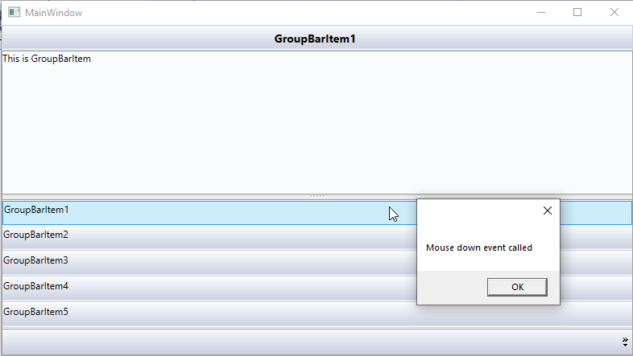

# How to Invoke a Command for GroupBarItem in WPF GroupBar
## Overview
The WPF GroupBar is a navigation control that allows grouping of related content in collapsible panels. It is commonly used in applications that require categorized navigation, such as dashboards or settings panels. By associating commands with GroupBar items, developers can enhance interactivity and maintain a clean separation between UI and logic using the MVVM pattern.

This example demonstrates how to invoke a command for a GroupBarItem in the Syncfusion WPF GroupBar control using the MVVM pattern. Instead of handling events in code-behind, we use interaction triggers to bind the MouseDown event to a command in the ViewModel.

## Why This Is Useful
- **MVVM-Friendly**: Keeps UI logic separate from business logic.
- **Improved Maintainability**: Avoids code-behind event handlers.
- **Dynamic Navigation**: Execute commands when users interact with GroupBar items.

## Approach
- Define a command in the ViewModel.
- Use _EventToCommand_ behavior to bind the _MouseDown_ event of GroupBarItem to the command.
- Pass parameters if needed using _CommandParameter_.

## Code Example
**XAML**
```XAML
<syncfusion:GroupBar ItemsSource="{Binding GroupItemCollection}" VisualMode="StackMode">
    <syncfusion:GroupBar.ItemContainerStyle>
        <Style TargetType="{x:Type syncfusion:GroupBarItem}">
            <Setter Property="Header" Value="{Binding Header}" />
            <Setter Property="Content" Value="{Binding Content}" />
            <Setter Property="IsSelected" Value="{Binding IsSelected}" />
        </Style>
    </syncfusion:GroupBar.ItemContainerStyle>

    <i:Interaction.Triggers>
        <i:EventTrigger EventName="MouseDown">
            <command:EventToCommand Command="{Binding MouseDownClick}"
                                    CommandParameter="{Binding InvokeParameter}"
                                    PassEventArgsToCommand="True" />
        </i:EventTrigger>
    </i:Interaction.Triggers>
</syncfusion:GroupBar>
```

**Model and ViewModel (C#)**
```C#
public class ViewModel
{
    public ICommand MouseDownClick { get; set; }
    public ObservableCollection<Model> GroupItemCollection { get; set; }

    public ViewModel()
    {
        GroupItemCollection = new ObservableCollection<Model>
        {
            new Model() { Header = "GroupBarItem1", Content = "This is GroupBarItem", IsSelected = true },
            new Model() { Header = "GroupBarItem2", Content = "This is GroupBarItem1", IsSelected = true },
            new Model() { Header = "GroupBarItem3", Content = "This is GroupBarItem2", IsSelected = false },
            new Model() { Header = "GroupBarItem4", Content = "This is GroupBarItem3", IsSelected = true },
            new Model() { Header = "GroupBarItem5", Content = "This is GroupBarItem4", IsSelected = true }
        };

        MouseDownClick = new DelegateCommand<object>(MouseDownClicked);
    }

    private void MouseDownClicked(object obj)
    {
        MessageBox.Show("Mouse down event called");
    }
}

public class Model : NotificationObject
{
    public string Header { get; set; }
    public string Content { get; set; }
    public bool IsSelected { get; set; }
    public int InvokeParameter { get; set; } = 1;
}
```

## Notes
- Requires _Microsoft.Xaml.Behaviors.Wpf_ or _System.Windows.Interactivity_ for Interaction.Triggers.
- Use _CommandParameter_ to pass additional data to the command.
- This approach avoids code-behind and supports MVVM.

## Reference
For more details, refer to the official Syncfusion Knowledge Base article:
[How-to-invoke-the-command-for-groupbar-item-in-WPF-GroupBar](https://www.syncfusion.com/kb/12197/how-to-invoke-the-command-for-groupbar-item-in-wpf-groupbar-control)

## Output

